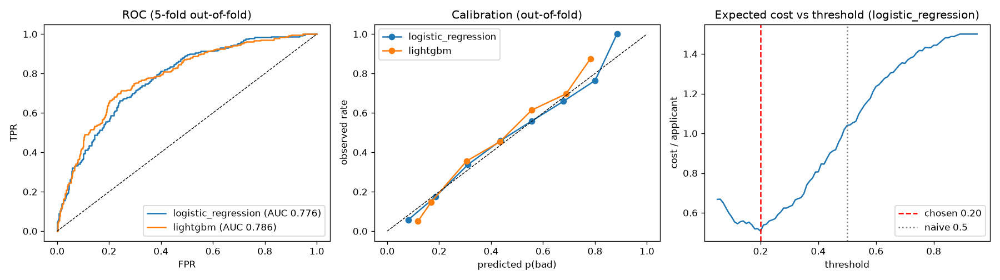

# Cost-Sensitive Credit Risk Scoring


A loan-approval model that optimises the thing a lender actually pays for: **expected cost**, not accuracy.

On the Statlog German Credit dataset, approving an applicant who later defaults costs **5x** more than
rejecting a good one. A classifier thresholded at the default 0.5 ignores that asymmetry. This project
builds calibrated probability models, picks the decision threshold that minimises expected cost on
out-of-fold predictions, and reports the result once on an untouched test split.

## Results (held-out 20% test split, 200 applicants)

| Decision rule | Cost per applicant | Relative to "approve everyone" |
|---|---|---|
| Approve everyone | 1.500 | - |
| Calibrated model, naive threshold 0.5 | 0.835 | -44% |
| Calibrated model, Bayes threshold 1/6 | 0.560 | -63% |
| **Calibrated model, threshold tuned on out-of-fold data (0.20)** | **0.545** | **-64%** |

Test ROC-AUC **0.806**, PR-AUC **0.640**, Brier **0.155**.

200 applicants is a small test set, so the headline number comes with a bootstrap interval (2,000 resamples):
the tuned rule's cost is **0.545 (95% CI 0.41-0.69)**, and its saving over the naive 0.5 threshold, measured on
the same resampled applicants, is **0.06-0.55 per applicant** - positive across the whole interval.

5-fold cross-validation on the training split:

| Model | ROC-AUC | PR-AUC | Brier | Cost / applicant |
|---|---|---|---|---|
| Logistic regression (one-hot + scaling) | 0.776 | 0.594 | 0.168 | **0.508** |
| LightGBM (ordinal-encoded) | 0.785 | 0.599 | 0.166 | 0.530 |

LightGBM ranks slightly better, but logistic regression gives the lower expected cost after
thresholding, so it is the model selected. Ranking quality and decision cost do not always agree.



Most important features (permutation importance, drop in test ROC-AUC): `checking_status` 0.095,
`credit_history` 0.030, `purpose` 0.027, `duration` 0.024, `credit_amount` 0.022.

## How it works

1. **Data** - `credit-g` from OpenML (1000 applicants, 20 mixed numeric/categorical features, 30% bad).
2. **Pipelines** - scikit-learn `ColumnTransformer` + model, so preprocessing is fit inside each fold (no leakage).
3. **Calibration** - `CalibratedClassifierCV` (Platt scaling), because a cost threshold only means something on calibrated probabilities.
4. **Model and threshold selection** - both chosen on 5-fold out-of-fold predictions of the training split.
5. **Single test evaluation** - the 20% test split is used once, at the end.
6. **Explainability** - permutation importance on the test split.

## Run it

```bash
pip install -r requirements.txt
PYTHONPATH=src python -m credit_risk.train      # writes reports/metrics.json, reports/evaluation.png, artifacts/
PYTHONPATH=src python -m credit_risk.predict applicants.csv
pytest -q
```

Runs on CPU in under a minute.

## Project layout

```
src/credit_risk/
  data.py      dataset loading and column typing
  models.py    preprocessing + model pipelines
  cost.py      cost matrix, expected cost, threshold search
  train.py     CV comparison, selection, test report, plots
  predict.py   score new applicants with the saved model
tests/         unit tests for the cost logic and pipelines
```

## License

MIT
